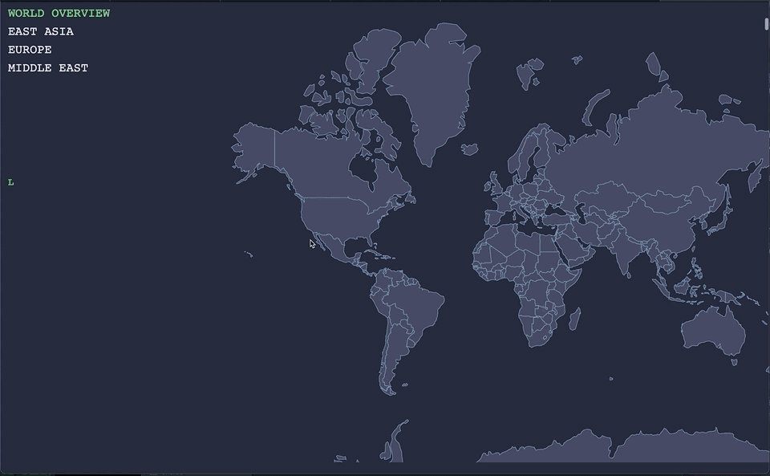

# World Military Spending in 2021

A scroll-driven data story about global military expenditure in 2021. As the reader scrolls, a world map highlights and zooms to the countries being discussed. Summary bars show each group's share of the total, and small trend charts show the last decade of spending for key countries.

**Live:** [hhur0104.github.io/data_vis_capstone](https://hhur0104.github.io/data_vis_capstone/)



A menu at the top left jumps between the four sections: world overview, East Asia, Europe and the Middle East.

## How it works

- **Scroll triggers:** [Scrollama](https://github.com/russellsamora/scrollama) watches 30 invisible step elements. Each step is defined in one table (`steps.js`) that says which countries to highlight, where the map zooms, which comparison bar to show and which trend chart to draw. A step sets its whole state on entry, so jumping with the menu or scrolling fast leaves no leftovers from earlier steps.
- **Map:** [D3](https://d3js.org) v7, with a Mercator projection of the Natural Earth 110m countries (TopoJSON). Zooms use `d3.zoom` transforms fitted to each country's bounding box.
- **Comparison bar:** a single horizontal bar showing a group (for example, the top 10 spenders) against its reference total (world or region).
- **Trend charts:** 2011–2021 line charts drawn next to the narrative, either for one country or for a few countries sharing an axis.
- **Narrative text:** typed out with a D3 text tween, to keep attention on the graphics rather than long paragraphs.

## Data

All spending figures come from the [SIPRI Military Expenditure Database](https://www.sipri.org/databases/milex), in current US dollars.

| File | Contents |
|---|---|
| `data/Milex.Current.csv` | Country-level spending by year, as downloaded from SIPRI |
| `data/Milex.Regional.csv` | Regional totals |
| `data/targets_mod.csv` | One row per map country: 2020/2021 spending, region, whether spending rose in 2021, top-10/top-20 flags |
| `data/trend_lastSvn.csv` | 2011–2021 series (USD billions) for the 12 countries with trend charts |
| `data/world-110.topo.json` | Natural Earth 110m country boundaries |

`data/makeTargetsDataset.R` builds `targets_mod.csv`. It matches SIPRI country names to the map's names, assigns regions, flags countries whose 2021 spending exceeded their 2020 spending, and ranks the top 10 and top 20.

## Running locally

The scripts are ES modules, so the page has to be served over HTTP rather than opened directly from disk:

```bash
git clone https://github.com/hhur0104/data_vis_capstone.git
cd data_vis_capstone
python3 -m http.server 8000
# open http://localhost:8000
```

It's designed for desktop browsers at laptop size or larger.

## Background

This was my capstone for the MS in Data Analysis and Visualization at the CUNY Graduate Center. The project asks whether an interactive, graphics-first format can carry a complex geopolitical topic that would normally be written up as a long-form article. The written thesis is on [CUNY Academic Works](https://academicworks.cuny.edu/gc_etds/5357/).

The narrative was written in spring 2023, and statements about current events reflect that time. The exact version submitted with the thesis is preserved on the [`thesis-2023`](https://github.com/hhur0104/data_vis_capstone/tree/thesis-2023) branch, and it still runs at [/thesis-2023/](https://hhur0104.github.io/data_vis_capstone/thesis-2023/).

## License

Code is released under the MIT License. Spending data © SIPRI, used under [SIPRI's terms](https://www.sipri.org/about/terms-and-conditions); map boundaries from Natural Earth (public domain).
